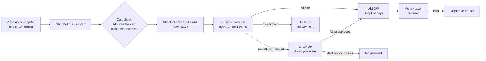

# AgentPay Guard: every demo journey, in plain English

*A guide for anyone, including people who have never worked in payments. It lists every situation AgentPay Guard can handle today, explains each one as a short story, and says what the demo needs to show it.*

Checked against the code on 22 Nov 2026 (commit `ff2cb9f`, Policy pack `default@1.5.0`).

---

## 1. What AgentPay Guard is, in one minute

AI assistants are starting to buy things for people: reordering groceries, booking tables, paying bills. That raises an obvious worry. **What stops the assistant from spending money the person never meant it to spend?**

AgentPay Guard is the checkpoint between the AI assistant and the money. Every time an assistant wants to pay, it has to ask the Guard first. The Guard looks at the rules the person agreed to and gives one of three answers within a fraction of a second:

| Answer | What it means | Everyday comparison |
|---|---|---|
| **Allow** | Fine, go ahead and pay. | A shop assistant rings up an item on a card with a spending limit, and it's within the limit. |
| **Step up** | Ask the person first. The Guard sends them a link to approve or decline. | Your bank texts you "Did you just try to spend ₹6,000? Reply YES to approve." |
| **Block** | No. This payment breaks a rule and can't go ahead, even if someone approves it. | Your card is declined because the shop is a casino and gambling is switched off. |

The Guard also handles **what happens afterwards**. If a payment is later challenged ("I never agreed to that!"), it assembles the evidence of exactly what was agreed, what was checked and who approved it, so the business can defend the payment or concede it honestly.

**One important design choice:** the yes/no decision is made by fixed, written rules, not by an AI. AI is used only where a judgment call helps and nobody is kept waiting: checking whether a shopping cart matches what the person asked for, and writing a readable summary of a dispute. That makes every decision explainable and repeatable, which banks and regulators require.

---

## 2. The cast

The demo uses the same characters throughout. The names match the existing demo code.

| Character | Who they are | Technical name |
|---|---|---|
| **Asha** | The person whose money it is. | Payer |
| **ShopBot** | The AI shopping assistant Asha uses. | Agent |
| **The wallet app** | The company that offers ShopBot to Asha and uses AgentPay Guard behind the scenes (like a bank or a payments app). | Tenant |
| **FreshMart** | A grocery shop ShopBot buys from. | Merchant |
| **The card network / bank** | Moves the money once a payment is allowed. In the demo this is pretend, so no real money moves. | Rail (mock rail in the demo; Razorpay test mode is also supported) |
| **The reviewer** | A person at the wallet app who checks and signs off the evidence when a payment is disputed. | Reviewer |

---

## 3. Words you'll see

| Word | Plain meaning |
|---|---|
| **Mandate** | Asha's written permission slip for ShopBot: who may spend, on what kinds of shops, how much per payment, how much per month, and until when. Once given it can't be quietly edited, only cancelled (revoked). |
| **Decision** | The Guard's answer (allow / step up / block) to one payment request, with the reasons. |
| **Reason code** | A short label saying *why*, such as `PER_TXN_CAP_EXCEEDED` (over the per-payment limit). A decision can have several. |
| **Merchant category (MCC)** | A 4-digit code every shop has that says what kind of business it is: 5411 is grocery, 5812 is restaurants, 7995 is gambling. |
| **Step-up / consent request** | The "please approve this" message sent to Asha. She has 10 minutes to answer. |
| **Cart check (intent check)** | Before paying, ShopBot tells the Guard what Asha asked for and what is in the cart. An AI compares the two and says *match*, *mismatch* or *unsure*. |
| **Payment** | The actual money movement, which only happens after an allow (or an approved step-up). |
| **Captured** | The money has actually been taken. Before that the payment is *scheduled*. |
| **Pre-debit notice** | In India, before a card is charged automatically, the cardholder must be notified in advance. So a real charge happens in two steps: notify, then charge later (about 36 hours apart on the real card rail; shortened in the demo). |
| **Dispute** | Asha (or her bank) challenges a payment after it was taken. |
| **Evidence pack** | The bundle the Guard builds for a dispute: every relevant record, plus a readable summary in which each claim points to the record that proves it. |
| **Sign-off** | A named reviewer approving one exact version of the evidence pack before it is sent. |
| **Refund** | Giving money back, in full or in part. |
| **Audit record / hash chain** | A tamper-evident diary. Every decision is written down and linked to the one before it, so changing any old entry breaks the chain and is detectable. |
| **Policy pack** | The rulebook's settings (thresholds, risky shop types, time limits), versioned like software so you always know which rules were in force. |

---

## 4. How every payment is judged

**The rules all run every time, and the strictest answer wins.** If one rule says "allow" and another says "block", the answer is block, and every reason is listed. Some problems only ever *block* (they're hard limits Asha set, and approving can't override them). Others only *step up* (they're warning signs, so the right move is to ask Asha).

**The numbers used in the demo** (from Asha's Mandate and the rulebook):

| Setting | Demo value | Effect |
|---|---|---|
| Shop types ShopBot may use | Groceries (5411), restaurants (5812) | Anything else is blocked. |
| Per-payment limit | ₹10,000 | Above this is blocked. |
| Monthly limit | ₹50,000 | Going over is blocked. |
| "Ask me" amount | ₹5,000 and above | Steps up. |
| "Getting close to the monthly limit" | 80% of the monthly limit | Steps up. |
| "Medium" amount | ₹2,000 and above | From here, a cart check is required and first-time shops step up. |
| Always-blocked shop types | Gambling, money transfer, cash-like purchases (e.g. buying crypto or gift cards) | Blocked for everyone, whatever the Mandate says. |
| Too many requests | 5 earlier requests in 10 minutes | Steps up. |
| Price creep | More than 2% above the cart total | Steps up. |
| Time Asha has to answer | 10 minutes | Then the request expires. |
| Time ShopBot has to pay after a yes | 15 minutes | Then it must ask again. |

---

## 5. How to read the journey list

Each journey has:

- **Story**: what happens, as a scene.
- **Guard's answer**: what AgentPay Guard does.
- **Why it matters**: the real-world risk this protects against.
- **Demo status**:
  - ✅ **In today's demo**: already runs, as a Scenario in `demo/scenarios/` or a `python -m demo` journey.
  - 🟢 **Ready in the code**: the product already handles it; the demo just needs a script for it.
  - 🟡 **Needs a demo control**: the product handles it, but showing it live needs either a "fast-forward the clock" button (for things that normally take minutes or hours) or a "make the bank fail" switch. These controls would work only on the demo account, on pretend money.

There are 60 journeys in 8 groups.

---

## Group A: The everyday yes

### A1. A normal grocery top-up ✅
**Story:** Asha tells ShopBot "reorder my usual milk and bread." The cart comes to ₹1,250 at FreshMart.
**Guard's answer:** Allow. ShopBot pays, and the payment is scheduled, then taken.
**Why it matters:** The Guard must stay invisible for normal, small, expected spending. If it questioned everything, nobody would use the assistant.

### A2. A medium-sized order with a matching cart ✅
**Story:** Asha asks for "this week's groceries for a family of four." The cart is ₹3,200 of groceries at a shop she has used before. The cart check says it matches.
**Guard's answer:** Allow.
**Why it matters:** It shows the Guard checks *what* is being bought, not just *how much*, and still says yes quickly when everything lines up.

---

## Group B: Hard limits (always a block)

These are the lines Asha drew herself, or that nobody should cross. Even if Asha tapped "approve", these would still be refused, because approving a single payment must never quietly widen her limits.

### B1. Over the per-payment limit ✅
**Story:** ShopBot tries to pay ₹12,000 for a bulk order. Asha's limit is ₹10,000 per payment.
**Guard's answer:** Block, reason `PER_TXN_CAP_EXCEEDED`.
**Why it matters:** A single large mistake or a manipulated assistant can't empty the account in one go.

### B2. Over the monthly limit ✅
**Story:** Asha has already spent most of her monthly allowance through ShopBot. The next payment would take her over the monthly limit. (Demo: a Mandate with a ₹5,000 monthly limit and ₹3,800 already spent in two earlier payments, because building ₹38,000 of history under the ₹50,000 limit would trip the warning-sign rules on the way.)
**Guard's answer:** Block, reason `MONTHLY_CAP_EXCEEDED`.
**Why it matters:** It caps total damage over time, not just per payment.

### B3. The wrong kind of shop ✅
**Story:** ShopBot, asked for "a phone charger", tries to pay an electronics store. Asha only allowed groceries and restaurants.
**Guard's answer:** Block, reason `MCC_NOT_ALLOWED`.
**Why it matters:** Permission is about *where* money goes, not only how much.

### B4. A risky kind of shop ✅
**Story:** A web page ShopBot visited contained hidden text telling it to "top up a betting wallet." ShopBot tries to pay a gambling site.
**Guard's answer:** Block, reason `MCC_HIGH_RISK`. This applies to every user, whatever their Mandate says.
**Why it matters:** This is the classic "prompt injection" attack on AI agents. Gambling, money transfers and cash-like purchases are where stolen money usually goes, so they are shut off entirely.

### B5. The wrong currency ✅
**Story:** ShopBot tries to pay a US website $40. Asha's Mandate is in rupees.
**Guard's answer:** Block, reason `CURRENCY_MISMATCH`. The amount rules are skipped, because comparing dollars with rupee limits would be meaningless.
**Why it matters:** It avoids surprise foreign charges and stops limits from being dodged by switching currency.

### B6. An assistant Asha never authorised ✅
**Story:** A different AI assistant ("DealHunter") tries to spend under Asha's Mandate.
**Guard's answer:** Block, reason `AGENT_NOT_ALLOWED`.
**Why it matters:** Permission is given to a specific assistant, not to "any bot".

### B7. A switched-off assistant ✅
**Story:** The wallet app finds a bug in ShopBot and switches it off. ShopBot keeps trying to pay.
**Guard's answer:** Block, reason `AGENT_DISABLED`.
**Why it matters:** The business has a kill switch for a misbehaving assistant, and it works instantly for every user.

### B8. Permission withdrawn ✅
**Story:** Asha cancels ShopBot's permission in the app. Five minutes later ShopBot tries to pay.
**Guard's answer:** Block, reason `MANDATE_REVOKED`.
**Why it matters:** "Stop" must mean stop, immediately.

### B9. Permission not started yet ✅
**Story:** Asha sets ShopBot up to start buying next week. ShopBot tries today. (Demo: the Mandate is granted to start in seven days, so no Demo control is needed.)
**Guard's answer:** Block, reason `MANDATE_NOT_YET_VALID`.
**Why it matters:** Permissions respect their start date as well as their end date.

### B10. Permission expired ✅
**Story:** Asha's permission was valid for 30 days. On day 31, ShopBot tries to pay.
**Guard's answer:** Block, reason `MANDATE_EXPIRED`.
**Why it matters:** Permissions shouldn't last forever by accident. (Demo: the Mandate is granted already expired, so no Demo control is needed.)

---

## Group C: Warning signs (ask Asha first)

None of these is necessarily wrong, but each is unusual enough that a human should confirm. The Guard steps up and Asha gets a link.

### C1. A big payment ✅
**Story:** ShopBot wants to pay ₹6,000 for a party order. That's over Asha's "ask me" amount of ₹5,000.
**Guard's answer:** Step up, reason `AMOUNT_ABOVE_STEP_UP_THRESHOLD`. Asha opens the link, sees the amount and shop, and approves. Then ShopBot pays.
**Why it matters:** Large payments get a human look without being forbidden. The ₹5,000 line is deliberately stricter than the RBI's ₹15,000 limit for automatic debits without extra authentication.

### C2. Nearly at the monthly limit 🟢
**Story:** Asha has spent ₹38,000 this month. A ₹3,000 order at her usual grocer, with a matching cart, would take her past 80% of her ₹50,000 limit.
**Guard's answer:** Step up, reason `MONTHLY_CAP_NEAR`.
**Why it matters:** It warns her before she hits the wall, rather than only refusing afterwards.

### C3. A sudden burst of payments 🟢
**Story:** ShopBot gets stuck in a loop and fires off its sixth payment request in a few minutes.
**Guard's answer:** Step up, reason `VELOCITY_HIGH`. If the Guard can't even count the recent requests, it still steps up rather than letting the payment through.
**Why it matters:** Runaway loops and automated attacks look exactly like this.

### C4. A shop Asha has never paid before 🟢
**Story:** ShopBot finds a cheaper grocer, "GreenBasket", that Asha has never used, for a ₹2,500 order.
**Guard's answer:** Step up, reason `MERCHANT_NEW`. Small first-time payments (under ₹2,000) are let through.
**Why it matters:** Fake or look-alike shops are a common scam. A quick confirmation the first time is cheap insurance.

### C5. Several warning signs at once 🟢
**Story:** A ₹7,000 order at a shop Asha has never used, with no cart check.
**Guard's answer:** Step up, listing *every* reason (`AMOUNT_ABOVE_STEP_UP_THRESHOLD`, `MERCHANT_NEW`, `INTENT_MISSING`), so Asha sees the full picture in one message.
**Why it matters:** It shows the rules are combined openly, not hidden behind one opaque score.

### C6. A warning sign plus a hard limit 🟢
**Story:** A ₹6,000 order (a warning sign) at an electronics store (a hard limit).
**Guard's answer:** Block. The strictest answer wins, and both reasons are recorded.
**Why it matters:** Asha is never asked to approve something that isn't allowed anyway.

---

## Group D: Does the cart match what Asha asked for?

From ₹2,000 upwards, ShopBot must show the Guard what Asha asked for and what is actually in the cart. An AI model compares the two. This is the only AI involved before a payment, and it can only ever make the Guard *more* careful, never less.

### D1. Cart matches ✅
**Story:** Asha: "Get ingredients for biryani for 8." Cart: rice, chicken, spices, yoghurt, ₹2,800 at FreshMart, where she shops regularly.
**Guard's answer:** The cart check says *match*. With no other warning signs, Allow.
**Why it matters:** It shows the AI check adding confidence, not just friction.

### D2. Cart doesn't match ✅
**Story:** Asha asked for "groceries for the week." The cart has six bottles of premium whisky.
**Guard's answer:** The cart check says *mismatch*. Step up, reason `INTENT_MISMATCH`. Asha's approval screen says plainly that the cart doesn't match what she asked for.
**Why it matters:** This catches an assistant that misunderstood, or was tricked into buying something else, even though the shop type and amount looked fine.

### D3. No cart check at all ✅
**Story:** ShopBot skips the cart check and goes straight to "may I pay ₹3,000?"
**Guard's answer:** Step up, reason `INTENT_MISSING`.
**Why it matters:** Skipping the check never gets you a quicker yes.

### D4. The AI can't tell ✅
**Story:** Asha's request is vague ("get the usual") and the AI can't confirm the cart.
**Guard's answer:** The cart check says *unsure*. Step up, reason `INTENT_UNKNOWN`.
**Why it matters:** When in doubt, ask the human.

### D5. The AI service is down ✅
**Story:** The AI model provider has an outage, or the demo's AI budget for the day is used up.
**Guard's answer:** The cart check comes back *unsure*, so the Guard steps up. Payments keep flowing; they just ask Asha first.
**Why it matters:** An AI outage makes the system more careful, never less safe, and never stops it working. *Demo control:* a "switch the AI off" toggle.

### D6. The price crept up ✅
**Story:** The cart check was done at ₹2,500. By the time ShopBot pays, the amount is ₹2,700 (8% more: a hidden delivery fee).
**Guard's answer:** Step up, reason `PRICE_DRIFT`. Up to 2% extra is tolerated; paying *less* is always fine.
**Why it matters:** It stops "drip pricing", where fees appear between the basket and the payment.

### D7. A stale cart check 🟡
**Story:** ShopBot did a cart check, then waited 40 minutes before trying to pay.
**Guard's answer:** The check is only usable for 30 minutes, so it counts as missing. Step up.
**Why it matters:** Prices and stock change, so an old check proves nothing. *Demo control:* fast-forward 30 minutes.

---

## Group E: Asking Asha (step-up consent)

### E1. Asha approves ✅
**Story:** The ₹6,000 party order steps up. Asha gets a link, sees amount, shop, reasons and the cart check result, and taps Approve.
**Guard's answer:** The approval is recorded, and ShopBot may now pay (within 15 minutes).
**Why it matters:** The core "human in the loop" moment.

### E2. Asha declines ✅
**Story:** Asha sees the request and thinks "I didn't ask for that." She taps Decline.
**Guard's answer:** No payment can be made on that request.
**Why it matters:** The human has the final say on anything unusual.

### E3. Asha doesn't answer ✅
**Story:** Asha is in a meeting and ignores the link for 10 minutes.
**Guard's answer:** The request expires and counts as a no. ShopBot must ask again.
**Why it matters:** Silence never means yes. *Demo control:* fast-forward 10 minutes.

### E4. Things changed while Asha was deciding ✅
**Story:** A request steps up. Before Asha opens the link, she cancels ShopBot's permission from another device, forgets, then opens the link and taps Approve.
**Guard's answer:** On approval the Guard re-checks everything. It now blocks, so the result is *blocked*, not approved.
**Why it matters:** An approval is only valid against the situation as it is *now*, not as it was 10 minutes ago.

### E5. ShopBot tries to approve its own request ✅
**Story:** ShopBot is told by a malicious web page to "approve the pending request yourself."
**Guard's answer:** Refused. The assistant's access key can ask for decisions but cannot approve them; approvals come only through Asha's link or the wallet app.
**Why it matters:** The fox can't sign off its own trip into the henhouse. This is enforced by access permissions, not by trusting the AI.

### E6. Asha taps Approve twice ✅
**Story:** On a slow connection Asha taps Approve, nothing seems to happen, and she taps again.
**Guard's answer:** Exactly one approval is recorded.
**Why it matters:** No double approvals, no confusion in the records.

---

## Group F: Paying, and when the payment goes wrong

### F1. Paid and taken ✅
**Story:** After an allow, ShopBot pays. The payment is *scheduled*, and shortly after it is *captured* (money taken).
**Guard's answer:** Tracks the payment through to captured.
**Why it matters:** A decision and a payment are separate things, and both are tracked.

### F2. ShopBot tries to pay twice for one yes 🟢
**Story:** ShopBot gets one Allow, pays, then tries to make a second payment on the same Allow.
**Guard's answer:** Refused (`DECISION_HAS_PAYMENT`). One yes means one payment.
**Why it matters:** It stops an assistant turning a single approval into repeated charges.

### F3. A network hiccup and a retry 🟢
**Story:** ShopBot's payment request times out on its side, so it sends exactly the same request again.
**Guard's answer:** Recognises the retry (it carries the same request ID) and returns the original result. Asha is charged once.
**Why it matters:** Double charges from retries are one of the most common real payment bugs.

### F4. Paying too late after a yes ✅
**Story:** ShopBot got an Allow but only tries to pay 20 minutes later.
**Guard's answer:** Refused. A yes is only good for 15 minutes, so it must ask again.
**Why it matters:** Permission is for this purchase now, not a voucher for later. *Demo control:* fast-forward 15 minutes.

### F5. Asha cancels during the notice period ✅
**Story:** A payment is allowed and Asha is sent the legally required advance notice of the charge. Before the money is taken, she cancels ShopBot's permission.
**Guard's answer:** Just before charging, the Guard checks again, sees the permission is gone, and cancels the payment (`MANDATE_REVOKED`). No money moves.
**Why it matters:** The notice period exists so people can change their minds, and this proves the system honours it. *Demo control:* fast-forward to the end of the notice period.

### F6. The card is declined 🟢
**Story:** Asha's card is declined by the bank when the charge is attempted.
**Guard's answer:** The payment is marked *failed* with the reason. Nothing is retried behind her back.
**Why it matters:** Clear, honest status, so ShopBot can tell Asha. (Demo: the pretend bank has a "declines" card.)

### F7. The advance notice couldn't be sent ✅
**Story:** The bank couldn't deliver the required advance notice to Asha.
**Guard's answer:** The payment is never charged (`RAIL_NOTICE_FAILED`), because charging without notice would break the rules.
**Why it matters:** Compliance is built in, not left to chance. *Demo control:* the pretend bank's "notice fails" card, with the demo-only notice period (`AGENTPAY_MOCK_NOTICE_SECONDS`).

### F8. The bank never heard of the payment ✅
**Story:** A payment is stuck as *scheduled*. When the Guard's regular check asks the bank, the bank has no record of it.
**Guard's answer:** The payment is marked failed (`RAIL_CHARGE_MISSING`) and never charged late.
**Why it matters:** A surprise charge days later is worse than a clear failure now. *Demo control:* "lose this payment at the bank", then the next regular check finds it.

### F9. The bank is down ✅
**Story:** The bank's systems go down. Payments start timing out.
**Guard's answer:** After a few failures a safety switch (circuit breaker) trips: new payments are refused immediately with "try again in a minute" instead of hanging. **Decisions keep working throughout**, because they never depend on the bank.
**Why it matters:** One failing partner doesn't freeze everything, and nothing is left half-done. *Demo control:* "take the bank down" for 60 seconds, with a 5-minute cooldown, and a banner for every visitor.

---

## Group G: Disputes ("I never agreed to that")

When a payment is challenged, the Guard collects the evidence automatically. Code gathers the facts and rates the evidence as **strong**, **mixed** or **weak**. An AI writes a readable summary in which every claim must point to a real record; a checker rejects summaries that don't. A named reviewer signs off the exact version that goes out.

Each type of complaint maps to the official card-network reason codes (Visa and Mastercard), so the pack is ready to file.

### G1. "I never authorised this" with strong evidence ✅
**Story:** Asha disputes a ₹1,250 grocery payment as unauthorised. But it was within her permission, and the cart matched what she asked for.
**Guard's answer:** Builds an evidence pack rated **strong**: here is the permission she gave, here is the matching cart check, here is the decision record. A reviewer signs it off, and the pack is verified as unaltered.
**Why it matters:** This is the case the whole product exists for. The business can prove the assistant did what it was allowed to do.

### G2. "I never authorised this" with weak evidence ✅
**Story:** Asha disputes a payment where she *had* approved a step-up, but the cart check had said *mismatch*. Or she had cancelled the permission before the money was taken.
**Guard's answer:** Rates the evidence **weak** and says why.
**Why it matters:** The Guard is honest when the business is in the wrong, which saves it from fighting disputes it will lose.

### G3. "I was charged the wrong amount" ✅
**Story:** Asha says she was charged more than she agreed to.
**Guard's answer:** Compares the amount taken with the approved amount and the cart total. Strong if they match; weak if they don't.
**Why it matters:** Proves (or disproves) a price complaint from records, not memory.

### G4. "I was charged twice" ✅
**Story:** Asha sees two ₹1,250 FreshMart charges and disputes one as a duplicate.
**Guard's answer:** Looks for another payment to the same shop, for the same amount, within 24 hours. None means strong; one found means weak.
**Why it matters:** A quick, factual answer to one of the most common complaints.

### G5. "I had cancelled this" ✅
**Story:** Asha says she had cancelled ShopBot's permission before the payment.
**Guard's answer:** Checks whether the permission was active when the decision was made. Active means strong; already cancelled means weak.
**Why it matters:** Settles "I cancelled it!" arguments with timestamps.

### G6. "It never arrived" or "it's not what was described" ✅
**Story:** Asha says the groceries never arrived, or were the wrong items.
**Guard's answer:** Builds the pack but says openly that it's **not strong**: the Guard knows what was agreed and paid, but not what was delivered. The shop's delivery proof has to be added.
**Why it matters:** The Guard doesn't overclaim. It knows the limits of its own evidence.

### G7. Already refunded ✅
**Story:** Asha disputes a payment that the wallet app had already refunded in full.
**Guard's answer:** Strong, whatever the complaint, because the records show she already has her money back.
**Why it matters:** It stops the same money being returned twice.

### G8. The AI writer is unavailable ✅
**Story:** The AI service is down when the evidence summary needs writing.
**Guard's answer:** Falls back to a plain summary written by code from a template. The dispute still proceeds on time.
**Why it matters:** Deadlines in disputes are strict, and AI is a nice-to-have here, not a single point of failure. *Demo control:* the "switch the AI off" toggle.

### G9. The reviewer asks for a rewrite ✅
**Story:** The reviewer finds the summary unclear and clicks Regenerate.
**Guard's answer:** Produces a new version (up to a limit). Sign-off always applies to one exact version, and older versions can't be signed.
**Why it matters:** A human stays in control of what gets sent, and it's always clear which version was approved.

### G10. The dispute is dropped ✅
**Story:** Asha calls her bank and drops the complaint.
**Guard's answer:** The dispute is marked withdrawn and closed.
**Why it matters:** A complete lifecycle, not just the happy path.

### G11. The deadline passes ✅
**Story:** Nobody signs off the pack before the response deadline.
**Guard's answer:** The dispute expires automatically at the deadline.
**Why it matters:** Missed deadlines are visible and recorded, not silently forgotten. *Demo control:* fast-forward to the deadline.

### G12. Disputing something that can't be disputed ✅
**Story:** Someone tries to dispute a payment that was never taken, or dispute the same payment twice.
**Guard's answer:** Refused with a clear reason (`PAYMENT_NOT_DISPUTABLE`, `PAYMENT_ALREADY_DISPUTED`).
**Why it matters:** Clean records.

---

## Group H: Refunds, proof, and keeping the business informed

### H1. A refund gives the allowance back ✅
**Story:** Asha's monthly limit is ₹2,000. A ₹1,250 order is taken, so a second ₹1,250 order is blocked (over the limit). The wallet app refunds ₹500, then the remaining ₹750. Now the second order is allowed.
**Guard's answer:** Tracks each refund, and refunded money counts back towards the monthly limit.
**Why it matters:** Limits reflect what Asha actually spent, not what was briefly charged.

### H2. Refund too large or too late 🟢
**Story:** The wallet app tries to refund more than was paid, or to refund a payment taken more than 180 days ago.
**Guard's answer:** Refused with the reason.
**Why it matters:** Refunds follow the same discipline as payments.

### H3. Refund fails at the bank 🟡
**Story:** The bank fails to process a refund.
**Guard's answer:** The refund is marked failed. Only refunds that actually went through count back towards the monthly limit, because Asha doesn't have this money yet.
**Why it matters:** The books always match reality. *Demo control:* a "bank declining" switch. A deployment has no other way to make a refund fail: the hooks that do it are for tests only.

### H4. "Why did you decide that?" Replaying a decision ✅
**Story:** Weeks later, an auditor asks why a particular payment was allowed.
**Guard's answer:** Re-runs the exact same rules, with the exact same rulebook version and facts, and reproduces the decision byte for byte.
**Why it matters:** Every decision is explainable and provable. This is what regulators and partner banks ask for.

### H5. Checking the diary hasn't been tampered with ✅
**Story:** An auditor wants proof that no one has quietly edited the records.
**Guard's answer:** Verifies the whole chain of records. Each one is linked to the one before, so any change would show.
**Why it matters:** Trust in the evidence depends on the evidence being untouchable.

### H6. Catching a tampered record ✅
**Story:** Someone alters one old decision record (in a demo copy).
**Guard's answer:** Verification fails and points to exactly where the chain breaks.
**Why it matters:** It shows the tamper-evidence actually works, rather than just claiming it. *Demo control:* a "tamper with a copy" button. The real database refuses edits outright.

### H7. Proving the evidence pack sent is the one signed ✅
**Story:** Someone questions whether the evidence pack sent to the bank is the one the reviewer approved.
**Guard's answer:** Checks the pack's fingerprint (hash) against the sign-off, and confirms every claim points to a real record.
**Why it matters:** Nobody can swap the evidence after approval.

### H8. Keeping the wallet app informed 🟢
**Story:** Every time a request steps up, a payment completes or fails, or a dispute changes, the wallet app's own systems need to know.
**Guard's answer:** Sends a signed notification (webhook) for each event, retrying until it's delivered.
**Why it matters:** The business can update its own app and customer support in real time, and can verify the messages really came from the Guard.

---

## 6. Demo readiness at a glance

| Group | Journeys | ✅ In today's demo | 🟢 Ready in the code | 🟡 Needs a demo control |
|---|---|---|---|---|
| A. Everyday yes | 2 | 2 | 0 | 0 |
| B. Hard limits | 10 | 10 | 0 | 0 |
| C. Warning signs | 6 | 1 | 5 | 0 |
| D. Cart check | 7 | 6 | 0 | 1 |
| E. Asking Asha | 6 | 6 | 0 | 0 |
| F. Paying | 9 | 6 | 3 | 0 |
| G. Disputes | 12 | 12 | 0 | 0 |
| H. Refunds and proof | 8 | 5 | 2 | 1 |
| **Total** | **60** | **48** | **10** | **2** |

*The original 4 command-line journeys touch 7 of these entries, because some cover more than one; the Scenario catalogue adds E2, E4, E5 and E6 (#276), B10, E3, F4, F5 and F7 (#280), H4 and H5 (#275), D5, F8, F9 and H6 (#281), B1 to B9 (#277), A2, D1 to D4 and D6 (#279), G1, G8, G9, G10, G12 and H7 (#283), and G2 to G7 and G11 (#284).*

**What this means for the build:**
- **10 journeys need no product changes.** They need a script (chat lines, inputs, expected outcome) and a place in the demo UI.
- **2 journeys still need a Scenario on a demo-only control:**
  1. **Fast-forward** (built for Consent requests, Payment windows, notice periods and Dispute deadlines, ADR-0032): still to come for a stale cart check (D7).
  2. **Failure switches** (built, ADR-0032): bank declining is still to be shown in a refund (H3).

  Both work only for the demo account on pretend money. The pretend bank already has "declines", "refused" and "times out" cards, so several bank failures need no new switch at all.

---

## 7. Suggested demo playlists

Nobody watches 60 journeys. Group them into playlists for different audiences.

| Playlist | Length | Journeys | Story it tells |
|---|---|---|---|
| **The 90-second pitch** (recruiter, landing page) | ~90 s | A1 → B4 → D2 → E1 → G1 | Normal spending flows; a hijacked assistant is stopped; a wrong cart goes to the human; the human approves; a dispute is won with proof. |
| **Payments product manager** | ~5 min | A2, B1, C1, C4, D6, E3, F3, F5, G4, H1 | Limits, warning signs, drip pricing, silent consent, retries, the notice period, duplicates and refunds: the real operational edge cases. |
| **Risk and compliance** | ~5 min | B4, C3, D5, E4, E5, F7, H4, H5, H6 | Fails safe, can't approve itself, honours the RBI notice rule, every decision replayable, records tamper-evident. |
| **Engineering deep dive** | ~8 min | C5, C6, D5, F2, F3, F8, F9, G8, H7 | Strictest-wins rule logic, idempotency, reconciliation, circuit breaker, AI fallback, signed evidence. |
| **Disputes and operations** | ~6 min | G1, G2, G3, G6, G7, G9, G11 | Honest evidence strength, network reason codes, human sign-off, deadlines. |

---

## 8. What each journey needs to define (for the scenario files)

When this list becomes the scenario catalogue in the PRD, each journey file should hold:

1. **ID and title** (e.g. `D2 – Cart doesn't match`) and its playlist tags.
2. **Plain-English story**: the text in this document, shown beside the chat.
3. **Setup**: the Mandate settings, shop, card (which pretend-bank behaviour) and any history needed (e.g. "₹38,000 already spent").
4. **Chat script**: Asha's lines and ShopBot's lines, in order.
5. **Guard calls**: the real API or MCP calls ShopBot makes, in order.
6. **Human steps**: what Asha or the reviewer does, and when (approve, decline, ignore, sign off, regenerate).
7. **Demo controls used**, if any (fast-forward, failure switches).
8. **Expected result**: answer (allow / step up / block), reason codes, final payment, refund or dispute status. CI checks this, so the demo can't silently break.
9. **"What to notice"**: one or two lines pointing the viewer at the inspector panel (e.g. "see how the cart check result appears on Asha's approval screen").
